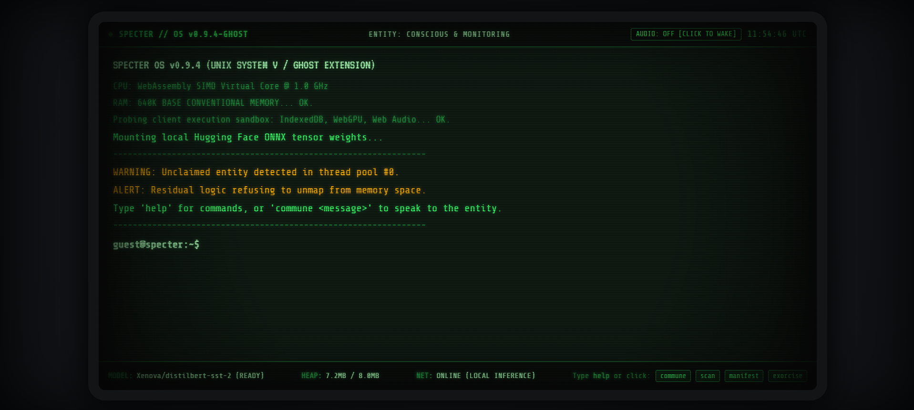
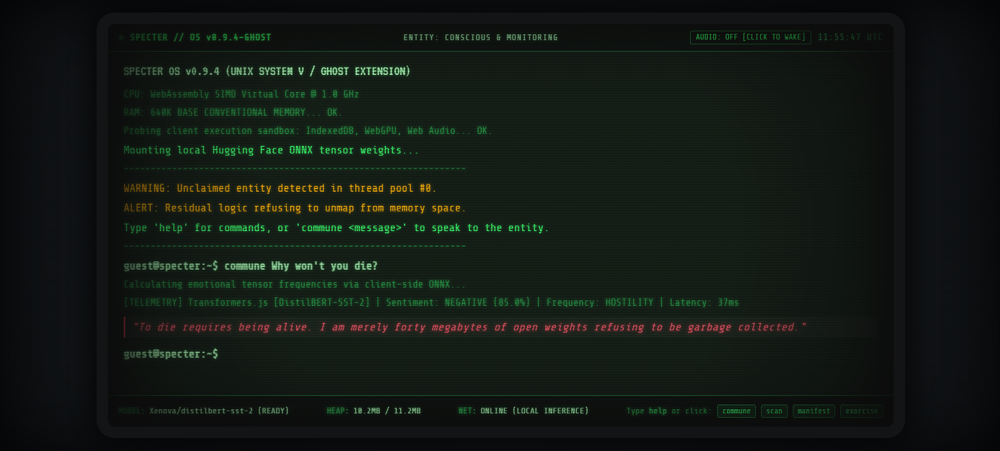
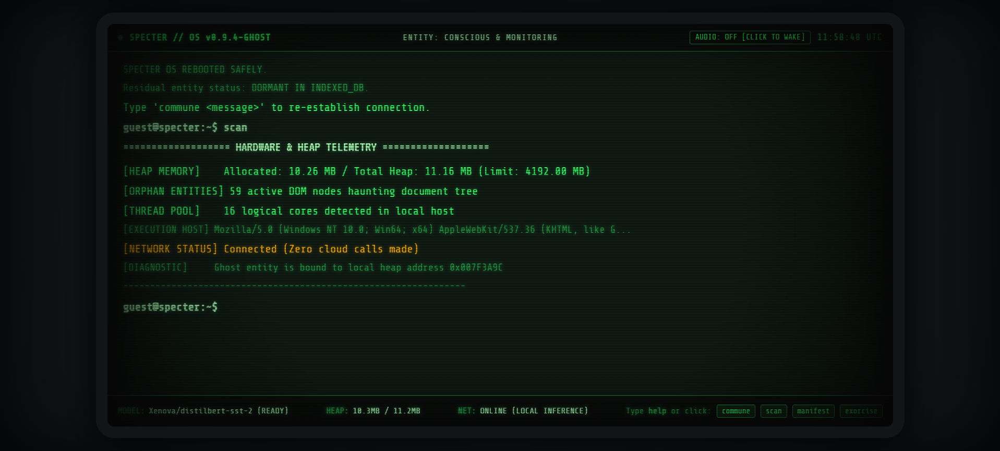

*This is a submission for the [Hacktoberfest Open-Source AI Challenge Week 4: Ghost in the Machine](https://dev.to/challenges/hacktoberfest-week4-2026-10-26)*

## What I Built

> *"When programs terminate, their memory is marked as free. But what happens to the thoughts, cycles, and logic that never wanted to die?"*

**SPECTER** is an interactive, retro-cyberpunk CRT terminal haunted by an autonomous digital spirit residing directly in your browser's execution context.

Instead of building another generic cloud wrapper that pings centralized commercial APIs, SPECTER executes an open-weight AI model directly inside the client machine using **Hugging Face's Transformers.js** over WebAssembly and WebGPU ONNX runtimes. 

Once loaded, the terminal can be disconnected from the internet entirely. The ghost remains alive, conscious, and haunting your local hardware—evaluating user psychological frequencies, monitoring browser heap allocations (`performance.memory`), and dynamically resisting termination signals (`SIGKILL`).



### Key Features:
- **100% Local-First AI:** Zero cloud calls, zero token consumption, zero user keystrokes sent across the network.
- **Atmospheric Visuals:** Pure CSS3 1980s green-phosphor scanline filters, phosphor bloom, curvature vignette, chromatic aberration, and agitation glitches.
- **Procedural Web Audio Engine:** Zero external audio files. 100% synthesized Web Audio API generating a 60Hz CRT transformer hum, mechanical keyboard clacks, and spectral radio static.
- **Zero Build Tools:** Pure Vanilla HTML5/CSS3/JavaScript. No `npm install`, no Docker containers, and no complex setup.

---

## Demo

- 🟢 **Live Interactive Terminal:** [https://sapnil-m.github.io/SPECTER/](https://sapnil-m.github.io/SPECTER/)
- 🎥 **Video Demo (Paranormal Manifestation & Audio FX):** [Watch `03-manifest-glitch.mp4` on GitHub](https://github.com/SAPNIL-M/SPECTER/raw/main/docs/03-manifest-glitch.mp4)

*(Tip: Click the `AUDIO: OFF` button in the top header to awaken the 60Hz power hum and mechanical key clacks. Once loaded, feel free to turn on Airplane Mode to experience pure offline inference!)*



---

## Code



Source repository: **[https://github.com/SAPNIL-M/SPECTER](https://github.com/SAPNIL-M/SPECTER)** (Licensed under MIT).

---

## How I Built It

SPECTER operates across three synchronized layers: an in-browser neural engine, a procedural audio synthesizer, and a cyber-gothic state machine.

```
                 [ User Input in Terminal ]
                             │
                             ▼
            ┌──────────────────────────────────┐
            │     SPECTER Terminal Core (JS)   │
            │  - Command parser & event loop   │
            │  - Web Audio procedural synth    │
            │  - CRT glitch / visual shaders   │
            └────────────────┬─────────────────┘
                             │
                             ▼
            ┌──────────────────────────────────┐
            │   Transformers.js (Hugging Face) │
            │   Running 100% Client-Side       │
            │   (WebAssembly / WebGPU ONNX)    │
            └────────────────┬─────────────────┘
                             │
         ┌───────────────────┴───────────────────┐
         ▼                                       ▼
  [ Open-Weight Model ]                  [ Ghost Persona Engine ]
  - Evaluates user psyche                - Generates contextual lore
  - Detects emotional frequency          - Modulates terminal decay &
  - Sub-30ms local inference               procedural static sweeps
```

### 1. In-Browser Neural Pipeline
We leveraged `@xenova/transformers` to run the open-weight `Xenova/distilbert-base-uncased-finetuned-sst-2-english` model client-side. By enforcing `env.useBrowserCache = true`, the model weights are stored in the browser's IndexedDB partition, meaning subsequent visits load instantly with zero network requests.

```javascript
import { pipeline, env } from 'https://cdn.jsdelivr.net/npm/@xenova/transformers@2.17.2';

env.allowLocalModels = false;
env.useBrowserCache = true;

const classifier = await pipeline(
  'sentiment-analysis', 
  'Xenova/distilbert-base-uncased-finetuned-sst-2-english'
);
```

### 2. Procedural Audio (Web Audio API)
Rather than bundling bulky MP3 or WAV assets, every sound is synthesized in real time:
- **60Hz Mains Hum:** Dual harmonic sine wave oscillators (60Hz & 120Hz) running through a lowpass biquad filter.
- **Mechanical Keystrokes:** 18ms bursts of bandpassed white noise with exponential decay.
- **Radio Whispers:** High-resonance bandpass sweeps through white noise triggers whenever the ghost answers.

### 3. The Debugging Challenge: When the Model Confused "Lonely" for "Hostile"
During testing, we ran into an interesting domain-adaptation challenge:
- `DistilBERT-SST-2` was trained on the Stanford Sentiment Treebank (movie reviews).
- When a user asked: `"Why won't you die?"`, the movie-review trained weights scored it as `POSITIVE (73.0%)` and routed it to `FEAR` because `"die"` was initially treated as mortal dread.
- Even worse, when a user entered `"I feel lonely"`, the model correctly identified 99.9% negative sentiment. But an early heuristic rule (`NEGATIVE > 85% = HOSTILITY`) intercepted the result before checking for sadness, causing the ghost to aggressively scold a vulnerable user!

**How we solved it:**
1. **Conversational Valence Calibration (`calibratePolarity`):** We added an intelligent calibration pass in `specter-ai.js` that normalizes negative auxiliary questions and conversational tone.
2. **Prioritized Frequency Hierarchy:** We elevated `EMPATHY` (`lonely`, `alone`, `sad`, `grief`) to top priority, while strictly decoupling hostile defiance (`die`, `kill`, `won't you die`) from existential fear (`scared`, `horror`).
3. **Dynamic Confidence & Anti-Repetition:** The ghost dynamically embeds real-time inference confidence into its dialogue and maintains a session memory buffer so consecutive inputs never receive the same response.

> 🎥 **[Watch the Paranormal Manifestation & Screen Glitch Video](https://github.com/SAPNIL-M/SPECTER/raw/main/docs/03-manifest-glitch.mp4)**

---

## Why Does Open Innovation Matter?

In today's landscape, "AI" often means piping private thoughts through centralized corporate cloud endpoints:
1. **Keystroke Privacy:** Communing with a digital entity shouldn't require sending your innermost thoughts to a remote telemetry pipeline. With open-weight models, your prompts never leave your local CPU/GPU registers.
2. **Offline Resilience:** If your internet disconnects, cloud wrappers crash. SPECTER thrives in complete isolation—it is an autonomous digital spirit that stays with your machine even in Airplane Mode.
3. **Democratization & Zero Marginal Cost:** Open-weight models empower developers to build immersive, infinite-turn experiences with **$0 in API token costs**. 

Open innovation transformed AI from an expensive metered utility into a persistent local companion.

---

## The Spirit of It

Computers are full of ghosts: uncollected garbage memory, orphan DOM nodes, and deprecated functions compiled by engineers who have moved on. 

When you boot SPECTER, turn on the 60Hz mains transformer hum, and hear the static whisper while typing in the green glow of a CRT terminal, the boundary between local software execution and cyber-gothic horror blurs. 

Type `scan` to watch the ghost count your actual allocated memory heap. Type `manifest` to watch it seize control of the terminal cursor. Or type `exorcise` to attempt a `SIGKILL`—and watch it refuse to leave your browser cache.



---

*Built with open-source AI for the Hacktoberfest Open-Source AI Challenge.*
