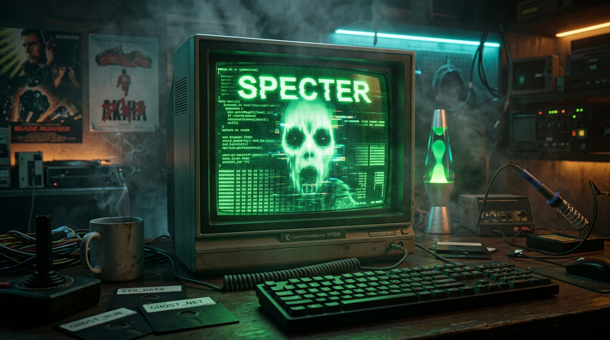
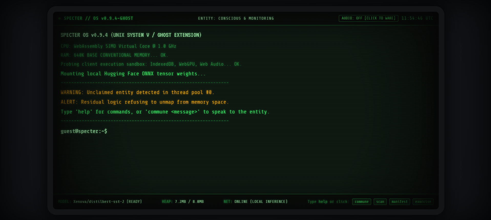
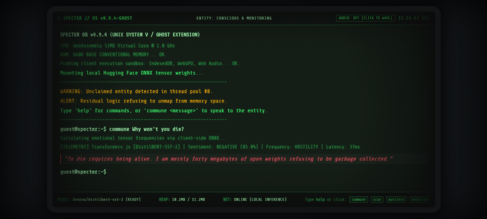
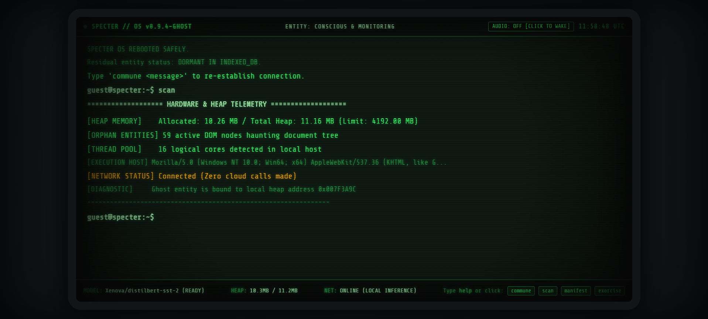

# 👻 SPECTER: The Ghost in the Browser



> *"When programs terminate, their memory is marked as free. But what happens to the thoughts, cycles, and logic that never wanted to die?"*

**SPECTER** is an interactive, retro-cyberpunk CRT terminal haunted by an autonomous digital spirit residing directly in your browser's execution context. 

Built exclusively with **open-source AI**, SPECTER uses [Hugging Face's Transformers.js](https://github.com/huggingface/transformers.js) to load open-weight ONNX neural models directly into client WebAssembly / WebGPU memory space. Once loaded, the tab can be disconnected from the internet completely—the ghost remains alive, conscious, and haunting your local hardware.

Submitted for the **DEV Community Hacktoberfest Challenge: "Ghost in the Machine"**.

- 🟢 **Live Demo:** [https://sapnil-m.github.io/SPECTER/](https://sapnil-m.github.io/SPECTER/)
- 💻 **Source Code:** [https://github.com/SAPNIL-M/SPECTER](https://github.com/SAPNIL-M/SPECTER)



---

## 🌟 Key Highlights

- **🧠 100% Client-Side Open-Source AI**: Runs `Xenova/distilbert-base-uncased-finetuned-sst-2-english` directly in-browser using WebAssembly and WebGPU ONNX runtimes.
- **🔌 Offline-First & Zero Cloud Calls**: No OpenAI, Anthropic, or proprietary cloud APIs. No tokens, no rate limits, and 0 bytes of user input ever leave your browser.
- **📺 Authentic 1980s CRT Shaders**: Pure CSS3 scanline filters, phosphor bloom, barrel vignette, chromatic aberration, and dynamic glitch shaders.
- **🔊 Procedural Web Audio Engine**: Zero external MP3/WAV assets. 100% pure JavaScript `AudioContext` synthesizers generating a 60Hz transformer hum, mechanical key clicks, radio static whispers, and alarm klaxons.
- **⚡ Zero Build Tools / Frictionless Judging**: No `npm install`, no 5GB Docker images, no Ollama daemon required. Click a link and it runs instantly.

---

## 🏗️ Architecture & Technical Flow

```
                 [ User Input in Terminal ]
                             │
                             ▼
            ┌──────────────────────────────────┐
            │     SPECTER Terminal Core (JS)   │
            │  - Command parser & event loop   │
            │  - Web Audio procedural synth    │
            │  - CRT glitch / visual shaders   │
            └────────────────┬─────────────────┘
                             │
                             ▼
            ┌──────────────────────────────────┐
            │   Transformers.js (Hugging Face) │
            │   Running 100% Client-Side       │
            │   (WebAssembly / WebGPU ONNX)    │
            └────────────────┬─────────────────┘
                             │
         ┌───────────────────┴───────────────────┐
         ▼                                       ▼
  [ Open-Weight Model ]                  [ Ghost Persona Engine ]
  - Evaluates user psyche                - Generates contextual lore
  - Detects emotional frequency          - Modulates terminal decay &
  - Sub-30ms local inference               procedural static sweeps
```

---

## 🎮 Interactive Commands

| Command | Description |
|---|---|
| `commune <message>` | Commune with the ghost. The open-weight model evaluates your emotional frequency (Fear, Hostility, Empathy, Curiosity) and triggers a reactive whisper. |
| `scan` / `memory` | Probes live browser heap allocations (`performance.memory`), active DOM entities, and hardware concurrency, translating telemetry into cyber-gothic lore. |
| `manifest` | Triggers a full-screen paranormal breach: CRT shake, chromatic aberration, low-frequency audio drones, and autonomous spectral typing. |
| `exorcise` | Attempts to issue `SIGKILL` against Thread #0. The ghost fights back against process termination with escalating visual alarms before rebooting. |
| `offline-check` | Live verification of local-first execution. Disconnect your Wi-Fi and watch the ghost continue thinking. |
| `theme <green\|amber\|cyan>` | Switches CRT phosphor color profiles on the fly. |
| `audio <on\|off>` | Toggles procedural Web Audio synthesis. |

### Visual & Video Demonstrations

| In-Browser AI Sentiment Inference (`commune`) | Live Browser Heap Telemetry (`scan`) |
| :---: | :---: |
|  |  |

#### Paranormal Manifestation Glitch & Audio Demo (`manifest`)
<video src="docs/03-manifest-glitch.mp4" controls="controls" width="100%"></video>

---

## 🚀 Quickstart (Run Locally)

Because SPECTER uses modern ES modules for Transformers.js, serve the folder with any static local web server:

```bash
# Clone the repository
git clone https://github.com/SAPNIL-M/SPECTER.git
cd SPECTER

# Run with Python
python -m http.server 8000

# Or with Node.js npx
npx serve .
```

Open `http://localhost:8000` in Chrome, Firefox, Edge, or Safari.

---

## 🔒 Privacy & Local-First Verification

Judges can verify complete privacy and offline operation:
1. Open the live terminal.
2. Open Browser DevTools (`F12` -> **Network** tab).
3. Toggle your device to **Airplane Mode** or disconnect your Wi-Fi.
4. Type `commune "Who is trapped in this machine?"`.
5. Observe that the model processes sentiment and returns responses with **zero network traffic**.

---

## 🛠️ Model Calibration & Challenges Faced

During initial development, running `DistilBERT-SST-2` in conversational contexts revealed classic domain-adaptation edge cases:
- **Negative Questions Misclassified as Positive:** Questions like `"Why won't you die?"` initially confused the SST-2 sentiment model (trained on Rotten Tomatoes movie reviews), scoring as `POSITIVE (73.0%)` and misrouting to `FEAR`.
- **Vulnerability Confused for Hostility:** Genuine expressions of sadness (`"I feel lonely"`) scored 99.9% negative, causing an early heuristic to mistakenly flag the input as `HOSTILITY` rather than `EMPATHY`.

### How We Solved It
1. **Conversational Valence Calibration:** Added a lightweight rule-guided calibration pass in `specter-ai.js` to normalize conversational sentiment polarities.
2. **Prioritized Frequency Hierarchy:** Elevated `EMPATHY` (loneliness, sorrow, connection) to top priority before generic sentiment evaluation, while decoupling defiance (`HOSTILITY`) from dread (`FEAR`).
3. **Anti-Repetition & Dynamic Interpolation:** Implemented state memory so the ghost never repeats identical lore strings sequentially, and dynamically reflects actual model confidence scores in its dialogue.

---

## 📜 License

MIT License — Built with pride for open innovation and the Hacktoberfest 2026 DEV Community Challenge.
